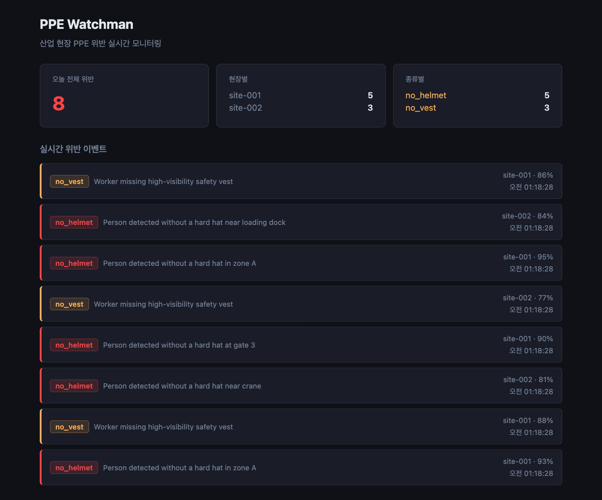

# PPE Watchman — edge camera alerts for missing hard hats and safety vests


PPE Watchman is a three-service pipeline for site-safety alerts. An edge client runs YOLO (fast object detector) on camera frames and sends small violation events to a FastAPI hub. The hub stores them in SQLite and pushes them to a live WebSocket dashboard. The goal is the systems work around a detector: edge vs. hub, link loss, many sites on one screen.

The repo name `mlops` is historical; the project is PPE Watchman.



*Captured from the running dashboard with sample events POSTed through the real `/events` API. Steps: [docs/DETAILS.md](docs/DETAILS.md#reproducing-the-screenshot).*

## What it shows

- 33 automated tests, all green in CI: 25 for the API hub, 8 for the violation rules.
- The edge detector keeps running when the hub link drops; it logs a warning and continues.
- A slow dashboard cannot stall the others: each subscriber has a bounded queue (size 100); overflow events are dropped.
- No accuracy, FPS or latency numbers exist yet. They need a PPE-tuned model and a labeled set.

Research angle: this is a small cyber-physical pipeline (sensors at the edge, a hub, operators). I cared most about what happens when parts fail: the edge survives without the hub, a slow client is dropped instead of blocking everyone, and the file frame source lets the whole chain be replayed offline for testing.

## How it works

- **detector** (edge PC or NVIDIA Jetson): reads frames, runs YOLOv8 on 1 of every N frames, applies site PPE rules, POSTs events.
- A per-kind cooldown stops one ongoing violation from spamming the API every frame.
- The edge sends a few KB per event, not a multi-MB/s video stream, so many sites fit one hub.
- **api** (on-prem server or cloud): validates with Pydantic, persists to SQLite, fans out to all dashboards over WebSocket `/ws`.
- **dashboard** (control-room browser): Next.js 14 live timeline plus per-site and per-kind daily counters.

Diagrams: [architecture flowchart and event sequence](docs/DETAILS.md#architecture).

## Run it

Requires Docker and a short video clip (the detector defaults to a file frame source).

```bash
cp .env.example .env
# Save any construction clip to samples/sample.mp4 (free clips: https://www.pexels.com/search/videos/construction/)
docker compose up --build        # Swagger: http://localhost:8000/docs   dashboard: http://localhost:3000
make api-venv && make api-test   # 25 API tests
make detector-test               # 8 violation-rule tests (needs numpy + pytest)
```

On first run the detector downloads `yolov8n.pt` from the Ultralytics CDN. CI (`.github/workflows/ci.yml`) runs `ruff` lint and both test suites on every push and pull request.

## Limitations

- The detection model is a stub: stock **COCO YOLOv8n** weights, not a PPE fine-tuned model. A documented heuristic fallback ("a detected `person` with no helmet/vest class in the same frame ⇒ violation") makes events flow end-to-end. Point `MODEL_PATH` at a hard-hat detector and the direct-label path (`no_helmet`, `no_vest`) takes over.
- No quantitative detection metrics (precision/recall) and no measured FPS/latency benchmarks.
- No authentication or authorization. One camera per detector (multi-camera = run more detector instances).
- The in-memory broadcaster assumes a single uvicorn worker; multi-worker fan-out needs Redis.

Not implemented (possible next steps): precision/recall with a PPE fine-tuned model on a labeled set; temporal smoothing (emit only after N consecutive violating frames). Four more items: [docs/DETAILS.md](docs/DETAILS.md#not-implemented).

## More

- [Details](docs/DETAILS.md): diagrams, design decisions, per-service dev setup, configuration variables, repository layout, screenshot reproduction, tech stack.

## License

MIT — see [LICENSE](LICENSE).

— Jun Hur · [portfolio](https://hurjun.github.io) · [KCC 2024 paper](https://hurjun.github.io/asset/kcc2024-kiise-nursing-record-paper.pdf) · hurjun96@gmail.com
